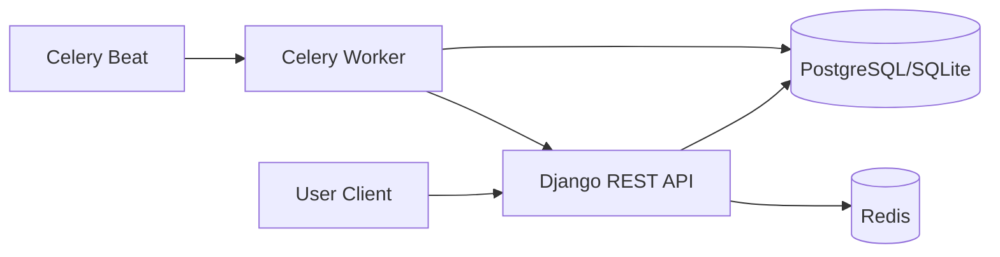

# Architecture

## High-Level Overview

PulseNotify is a Django REST API with asynchronous background processing via Celery and Redis.

## Components

- API layer: Django + DRF endpoints for auth, alert CRUD, admin summary, and mock flight prices.
- Background processing: Celery Beat schedules periodic checks and Celery Worker executes alert notifications.
- Data layer: PostgreSQL in production, SQLite for local/dev fallback.
- Auth: JWT authentication using `djangorestframework-simplejwt`.
- API contract: OpenAPI schema generated by DRF Spectacular.

## Core Runtime Flow

1. User creates alert via `POST /api/alerts/`.
2. Alert persists in DB as `active`.
3. Beat triggers `check_prices` every 60 seconds.
4. Task calls mock route `/api/flights/price/`.
5. Matching alert thresholds enqueue `send_notification` task.
6. Notification logs are persisted and alert status becomes `triggered`.

## Deployment Topology (Azure)

- Azure Resource Group
- Azure App Service Plan + Linux Web App (containerized Django)
- Azure Database for PostgreSQL Flexible Server
- Azure Cache for Redis

Terraform modules for each layer are under `infra/terraform/modules/`.
