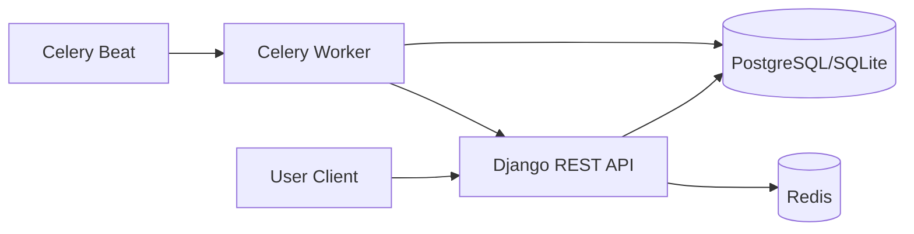

# Architecture

## High-Level Overview

PulseNotify is a Django REST API with asynchronous background processing via Celery and Redis.

## Design Goals

- Fast API response for user-facing actions.
- Decoupled background processing for periodic price checks.
- Clear role-based authorization for admin summary endpoints.
- Configurable runtime for local and cloud environments.

## Components

- API layer: Django + DRF endpoints for auth, alert CRUD, admin summary, and mock flight prices.
- Background processing: Celery Beat schedules periodic checks and Celery Worker executes alert notifications.
- Data layer: PostgreSQL in production, SQLite for local/dev fallback.
- Auth: JWT authentication using `djangorestframework-simplejwt`.
- API contract: OpenAPI schema generated by DRF Spectacular.

## Data Model Summary

- `UserProfile`
    - one-to-one with Django User
    - stores role (`admin` or `user`)
    - auto-created from `post_save` signal
- `PriceAlert`
    - user-owned route threshold definition
    - state machine: `active`, `inactive`, `triggered`
- `NotificationLog`
    - append-only event history of triggered alerts
    - links to source `PriceAlert`

## Core Runtime Flow

1. User creates alert via `POST /api/alerts/`.
2. Alert persists in DB as `active`.
3. Beat triggers `check_prices` every 60 seconds.
4. Task calls mock route `/api/flights/price/`.
5. Matching alert thresholds enqueue `send_notification` task.
6. Notification logs are persisted and alert status becomes `triggered`.

## Authorization Model

- Public endpoints
    - register
    - login
    - mock price feed
    - health
- Authenticated endpoints
    - alert create/list/delete
- Admin-only endpoint
    - admin summary (`IsAdminUser` checks `request.user.profile.role`)

## Reliability Considerations

- `check_prices` uses network exception handling for resilient polling.
- `send_notification` checks alert state before writing duplicate notifications.
- Celery and Redis configuration are environment-driven.

## Observability and Diagnostics

- Health endpoint: `/api/health/`
- OpenAPI schema for quick endpoint discovery and smoke checks.
- GitHub Actions workflow logs provide build, test, and infra traceability.

## Deployment Topology (Azure)

- Azure Resource Group
- Azure App Service Plan + Linux Web App (containerized Django)
- Azure Database for PostgreSQL Flexible Server
- Azure Cache for Redis

Terraform modules for each layer are under `infra/terraform/modules/`.

## Security Boundaries

- JWT tokens gate all non-public API operations.
- Secret values (DB creds, Django secret key, cloud credentials) are sourced from env/secrets, not committed in code.
- Infra apply is isolated to explicit workflow conditions and secret-backed credentials.
